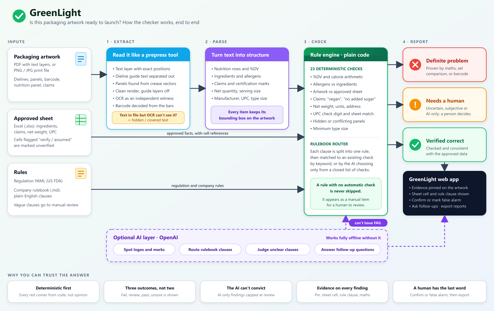

# GreenLight: Is this packaging artwork ready to launch?

*GreenLight turns "is the artwork ready to print?" into a clear red / amber / green answer: definite problems, items for a human, and what is verified correct. Built for Esko AIForge, Problem 2.*

Upload packaging artwork (PDF or image), the approved content sheet (.xlsx) and optionally a company rulebook (.md). Get a ranked list of **definite problems**, **items needing human review**, and **things that look correct**, each with evidence pinned on the artwork.

## How it works


## Why "GreenLight"
The question a packaging team asks before print is "can we give this the green light?". Every finding lands in one of three colours: **red** (proven problem), **amber** (a human must decide), **green** (checked and correct). Nothing is flagged red unless it is proven by arithmetic, set comparison, regex or a decoded barcode. The AI can only raise an amber "needs review".

## Requirements
- **Python 3.10+**
- **Tesseract OCR** binary on your PATH (used to cross-check the artwork and detect hidden text)
  - Windows: install from https://github.com/UB-Mannheim/tesseract/wiki, then add its folder (e.g. `C:\Program Files\Tesseract-OCR`) to PATH and reopen the terminal
  - macOS: `brew install tesseract`
  - Ubuntu/Debian: `sudo apt install tesseract-ocr`
- **OpenAI API key** (optional): enables the AI layer. Everything else works without it.

Python packages are listed in `requirements.txt` (PyMuPDF, Pillow, openpyxl, PyYAML, RapidFuzz, pytesseract, zxing-cpp, FastAPI, Uvicorn, python-multipart, openai, pytest).

## Install
```bash
git clone https://github.com/vini-dapooh/GreenLight.git
cd GreenLight

python -m venv .venv
# Windows (PowerShell):  .venv\Scripts\Activate.ps1
# macOS / Linux:         source .venv/bin/activate

pip install -r requirements.txt
```

## Enable the AI layer (optional)
```bash
cp .env.example .env        # Windows: copy .env.example .env
```
Edit `.env` and set your key:
```
OPENAI_API_KEY=sk-...
GREENLIGHT_MODEL=gpt-4o
```
`.env` is gitignored, so your key is never committed. You can also export `OPENAI_API_KEY` as a normal environment variable instead. Without a key the header chip shows "Offline · Deterministic Rules Engine" and every check still runs.

## Run
```bash
uvicorn app.server:app --port 8077
```
Open http://localhost:8077, click **Load the Dancing Fish sample** (or drop in your own artwork, content sheet and rulebook) and wait about 15 seconds.

In the report: use the **All / Definite / Review / Correct** tabs, the **‹ ›** buttons (or the arrow keys, or J/K) to step through findings, and click an evidence line to jump to it on the artwork. Mark each finding **Confirm** or **False alarm**, ask follow-up questions, and export HTML, CSV or JSON.

## Test
```bash
pytest -q tests
```
One test (`test_hidden_panel_is_review_not_fail`) needs Tesseract installed and will fail without it.

## Known limits
- Reviewer decisions (Confirm / False alarm) live in server memory for the session and are included in the exports. They are lost on server restart or page reload; avoid reloading mid-review.
- Tuned on one US carton; the nutrition parser targets US-style panels.
- Follow-up chat is limited to one finding's data by its prompt, and can only return text, never change a verdict.

## Troubleshooting
- **Port already in use:** run with another port, e.g. `--port 8078`.
- **Header says "Offline" although you set a key:** the `.env` file must be next to this README, and the server must be restarted after editing it.
- **No "hidden text" finding / OCR errors:** Tesseract is not installed or not on PATH.

## Layout
`app/extract.py` layers, OCR, panels, barcode, hidden text · `app/parse.py` structure · `app/checks.py` check primitives · `app/rulebook.py` + `app/rules/*.yaml` rules · `app/engine.py` orchestration · `app/llm.py` optional OpenAI layer · `web/index.html` UI · `samples/` demo files · `docs/` architecture, write-up, demo script.

See `docs/ARCHITECTURE.md` and `docs/SUBMISSION.md`.

## About
- **Project:** GreenLight
- **Problem statement:** Problem 2, is this packaging artwork ready to launch? Check artwork against the approved content sheet and the applicable rules before it goes to print.
- **Built by:** Vinit Khutey
- **Event:** Developed for the Esko AIForge hackathon.
