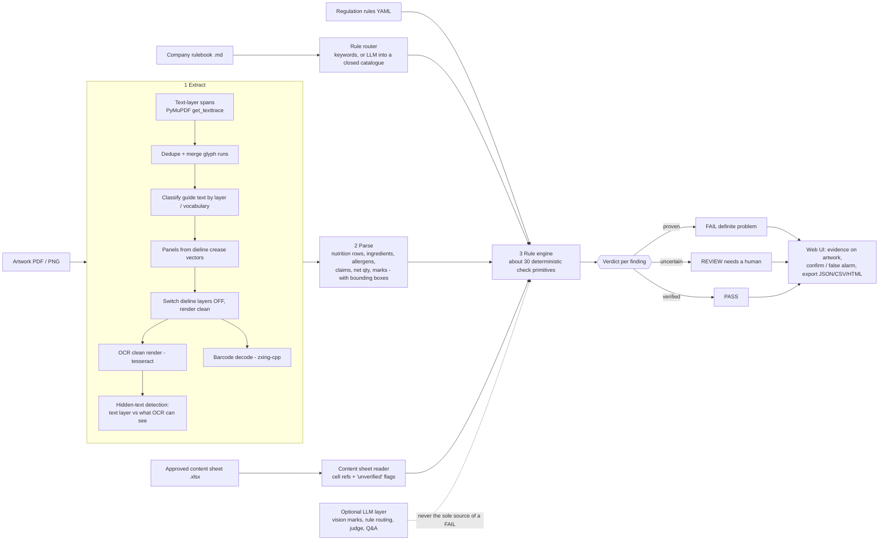

# GreenLight architecture

## Design rules that handle "uncertainty and wrong AI output"

| Principle | How it shows up |
|---|---|
| Deterministic first | Every FAIL comes from arithmetic, set comparison, regex or a decoded barcode - not from a model's opinion. |
| Three outcomes, not two | FAIL = proven problem. REVIEW = the system can't be sure. PASS = checked and OK. |
| The LLM can't convict | LLM-only findings are capped at REVIEW. Quotes it cites must exist in the PDF text layer, otherwise confidence is halved. |
| Evidence on every finding | Artwork box (pin-pointed to words), content-sheet cell reference, rule clause. |
| Source reliability | Content-sheet fields marked "verify / confirm / assumed" tag findings `approved-data-unverified`. |
| Degrades honestly | No text layer (PNG/scan)? Everything is OCR-read and any FAIL is capped to REVIEW at lower confidence, with the reason stated. |
| Nothing is silently skipped | Clauses with no automatic check (visual / subjective) appear as `manual` REVIEW items. |
| Human in the loop | Confirm / False-alarm per finding; exports carry the decision. |
